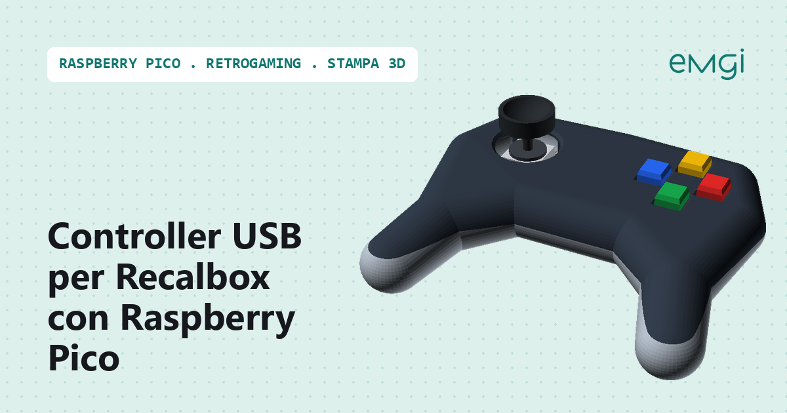
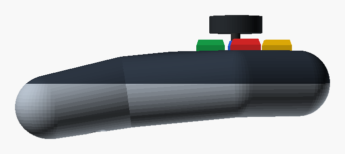
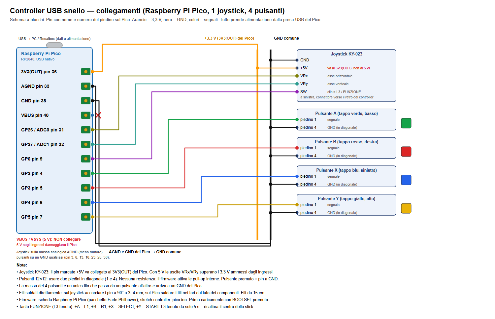
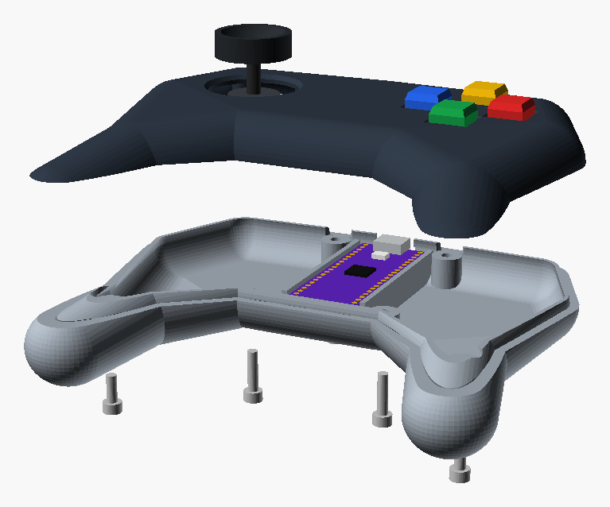

# Controller USB per Recalbox e PC con Raspberry Pico, joystick e guscio stampato in 3D

> 📖 **Articolo completo con spiegazioni passo passo:**  
> **[Controller USB per Recalbox e PC con Raspberry Pico, joystick e guscio stampato in 3D - www.emgi.it](https://www.emgi.it/2026/10/20/controller-usb-raspberry-pico-recalbox-stampato-3d/)**
>
> Altri progetti di elettronica, Arduino, ESP32, Home Assistant e stampa 3D su **[www.emgi.it](https://www.emgi.it)**

Un **gamepad USB** sottile, con un joystick analogico **KY-023**, quattro pulsanti e le impugnature lunghe dei pad degli anni '90, in un guscio stampato in 3D. Dentro c'è un **Raspberry Pi Pico (RP2040)**: con l'USB integrato si presenta come controller standard e funziona **senza driver** su PC Windows, Linux e Mac, Recalbox, RetroPie, Batocera e Android.

## Cosa fa il progetto

- **gamepad USB HID** standard, riconosciuto senza driver
- **joystick analogico** con zona morta e calibrazione automatica del centro all'accensione
- **croce digitale** (hat) ricavata dallo stick, per i giochi retro (disattivabile)
- **quattro pulsanti** A, B, X, Y con tappi colorati
- **tasto FUNZIONE**: tenendo premuto il clic del joystick i pulsanti diventano L1, R1, Select e Start (hotkey di Recalbox)
- **ricalibrazione** tenendo premuto il clic del joystick da solo per 5 secondi
- **guscio sottile**: 23 mm al centro, 134 × 111 mm, in due metà chiuse con sei viti M3

## Componenti utilizzati

- **Raspberry Pi Pico** (RP2040), originale con micro-USB o clone con **USB-C** della stessa misura (21 × 51 mm)
- modulo joystick **KY-023**
- 4 pulsanti tattili **12×12×7,3** con tappo quadrato 10×10 (verde, rosso, blu, giallo)
- cavo USB **dati** (non solo ricarica)
- viti: 4 × M3×12 e 2 × M3×8 a testa cilindrica (chiusura, le M3×8 nelle impugnature), 5 × M3×6 a testa tonda (joystick e piastrina)
- circa 90 g di **PLA o PETG**, filo flessibile 0,14–0,25 mm², guaina termorestringente

Costo indicativo **10-15 €**.

## Collegamenti elettrici

Schema completo: [`documentazione/schema_collegamenti.png`](documentazione/schema_collegamenti.png) (anche in [SVG](documentazione/schema_collegamenti.svg)).

| Componente | Pin | Raspberry Pi Pico |
|---|---|---|
| Joystick KY-023 | VRx | GP26 / ADC0 (pin 31) |
| Joystick KY-023 | VRy | GP27 / ADC1 (pin 32) |
| Joystick KY-023 | SW (clic = L3 / FUNZIONE) | GP6 (pin 9) |
| Joystick KY-023 | +5V | **3V3(OUT) (pin 36)** |
| Joystick KY-023 | GND | AGND (pin 33) |
| Pulsante A (basso, verde) | piedino 1 | GP2 (pin 4) |
| Pulsante B (destra, rosso) | piedino 1 | GP3 (pin 5) |
| Pulsante X (sinistra, blu) | piedino 1 | GP4 (pin 6) |
| Pulsante Y (alto, giallo) | piedino 1 | GP5 (pin 7) |
| 4 pulsanti | piedino 4 | GND (pin 38 o un altro GND), un filo che passa da un pulsante all'altro |

Note:
- **Alimentazione**: tutto è alimentato dalla presa USB del Pico. Il pin del joystick marcato **+5V va al 3V3(OUT)**, non a VBUS o VSYS: gli ingressi del Pico reggono 3,3 V.
- **Masse**: il joystick va sulla massa analogica **AGND** (assi più stabili), i pulsanti su un GND qualsiasi (pin 3, 8, 13, 18, 23, 28, 38). Tutte le masse del Pico sono comuni.
- **Pulsanti**: nessuna resistenza, il firmware attiva le pull-up interne (`INPUT_PULLUP`); premuto = pin a GND. Usare due piedini **in diagonale** (1 e 4): quelli sullo stesso lato sono già collegati tra loro.
- I fili si saldano direttamente: i connettori Dupont non entrano nel guscio.

## Contenuto del repository

| Percorso | Contenuto |
|---|---|
| `firmware/controller_pico/` | Sketch per Arduino IDE (pacchetto Raspberry Pi Pico/RP2040 di Earle F. Philhower) |
| `stl/` | I tre pezzi da stampare: guscio sopra (già capovolto), guscio sotto, piastrina dei pulsanti |
| `openscad/` | Sorgente parametrico OpenSCAD del guscio |
| `documentazione/guida_montaggio.html` | Guida di montaggio in 7 passi con lista materiali, disegni 3D e tabella dei collegamenti (si apre nel browser) |
| `documentazione/schema_collegamenti.*` | Schema a blocchi dei collegamenti |
| `immagini/` | Immagini dell'articolo |

## Come si usa

1. Stampa i tre pezzi in PLA o PETG (layer 0,2 mm, 3 perimetri, 20%, supporti ad albero solo dal piatto sotto le impugnature). Prima misura joystick e Pico e, se serve, correggi `joy_fori`, `joy_alt`, `pm_sp` e `usb_h` in [`openscad/controller_pico.scad`](openscad/controller_pico.scad).
2. Nell'Arduino IDE installa il pacchetto **Raspberry Pi Pico/RP2040/RP2350** di Earle F. Philhower (URL: `https://github.com/earlephilhower/arduino-pico/releases/download/global/package_rp2040_index.json`). Nessuna libreria da aggiungere.
3. Apri [`firmware/controller_pico/controller_pico.ino`](firmware/controller_pico/controller_pico.ino), scheda **Raspberry Pi Pico**. Il primo caricamento si fa con **BOOTSEL** premuto mentre si collega il cavo (porta `UF2_Board`); i successivi partono da soli.
4. Monta e collega seguendo la [guida di montaggio](documentazione/guida_montaggio.html) (scaricala e aprila nel browser) e la tabella qui sopra.
5. Collega il cavo senza toccare lo stick (calibrazione del centro) e provalo con `joy.cpl` su Windows o dalla configurazione controller di Recalbox.

| Combinazione | Funzione |
|---|---|
| L3 + Y | Start |
| L3 + X | Select (hotkey di Recalbox) |
| L3 + A | L1 |
| L3 + B | R1 |
| L3 premuto e lasciato | clic L3 |
| L3 tenuto da solo 5 s | ricalibra il centro dello stick |

Se un asse va al contrario, cambia `INVERTI_X`, `INVERTI_Y` o `SCAMBIA_XY` in testa allo sketch. Dal monitor seriale, inviando `d`, si vedono i valori grezzi dello stick.

Dettagli, scelte di progetto e risoluzione dei problemi: **[articolo su www.emgi.it](https://www.emgi.it/2026/10/20/controller-usb-raspberry-pico-recalbox-stampato-3d/)**.

## Crediti

- [arduino-pico](https://github.com/earlephilhower/arduino-pico) di Earle F. Philhower - pacchetto Arduino per RP2040 con il joystick USB

## Licenza

- Codice: [MIT](LICENSE)
- Modelli 3D, schema, guida e immagini: [CC BY-SA 4.0](https://creativecommons.org/licenses/by-sa/4.0/deed.it)

---

**Autore:** Massimiliano Sandrin - **[eMGi.it](https://www.emgi.it)** · Domande e commenti sotto l'[articolo sul sito](https://www.emgi.it/2026/10/20/controller-usb-raspberry-pico-recalbox-stampato-3d/).
